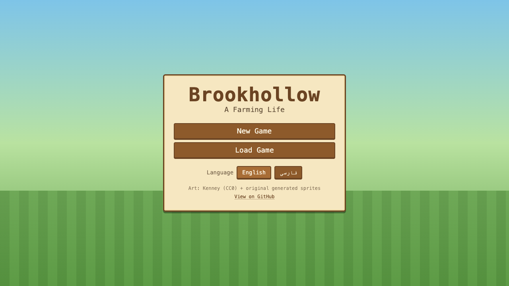
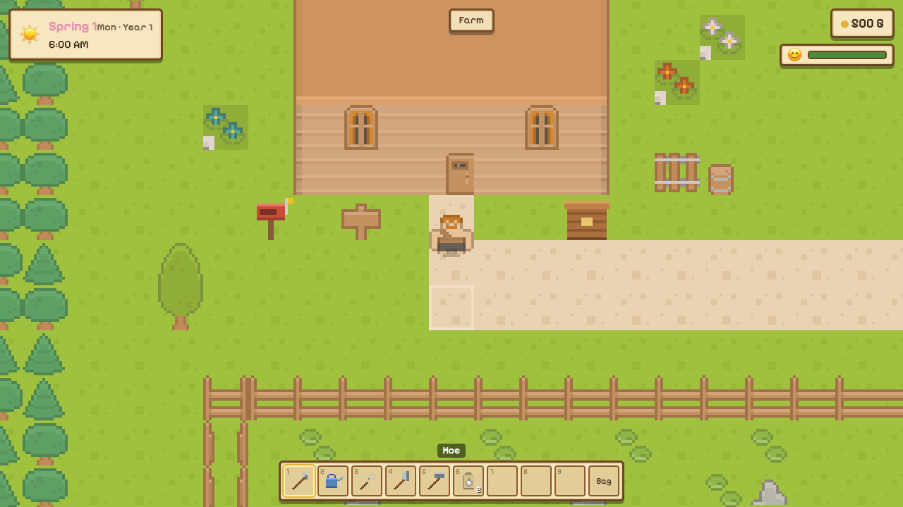
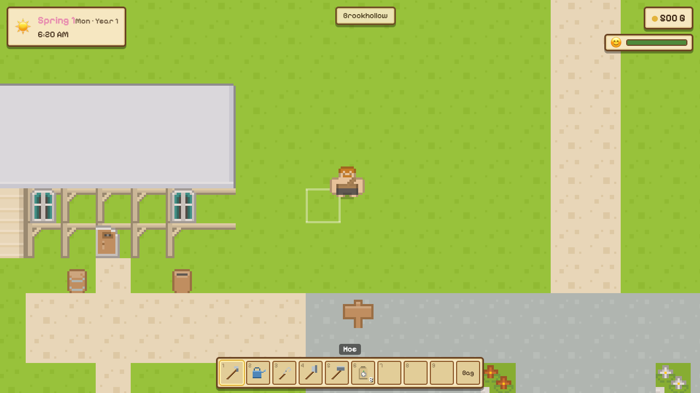

[English](#brookhollow) · [فارسی](#fa)

# Brookhollow

A browser farming-life sim. You inherit a neglected farm in the village of Brookhollow, clear the field, grow seasonal crops, ship the harvest, and get to know the neighbours. On the first day of spring in Year 4, the mayor walks the farm with you.

Play it at [https://brookhollow.dpouya.com](https://brookhollow.dpouya.com). Source: [github.com/pouyade/Brookhollow](https://github.com/pouyade/Brookhollow).

The repo name is `hmbtn`. The game title in the UI is Brookhollow.

## Screenshots

<p>
  
  
</p>
<p>
  
</p>

## Play

Requires Node.js 22.

```bash
npm install
npm run dev
```

Open the URL Vite prints (usually `http://localhost:5173`).

| Script | What it does |
| --- | --- |
| `npm run dev` | Start the dev server |
| `npm run build` | Typecheck and build to `dist/` |
| `npm run preview` | Serve the production build |
| `npm test` | Run the simulation tests once |
| `npm run test:watch` | Re-run tests on change |
| `npm run typecheck` | Typecheck without building |

## Controls

| Action | Keys |
| --- | --- |
| Move | WASD or arrow keys |
| Use the held tool / sow seeds | Space |
| Talk, harvest, open objects | E |
| Next / previous hotbar item | Q / Shift+Q |
| Select a hotbar slot | 1–9 |
| Bag | I |
| Journal | J |
| Menu | Esc |

The clock runs outdoors and pauses inside buildings. Days start at 6:00. Stay out past 2:00 and you collapse: the doctor carries you home and takes a fee (10% of your gold, up to 1000 G). Sleeping in the farmhouse bed ends the day and saves.

## What you can do

**Farm.** The field starts covered in weeds, rocks, and stumps. Hoe to till, sow a seed bag over a 3×3 of tilled soil, and water every day that it does not rain. Crops only advance overnight if the soil was watered. Rain and storms water the field for you. Harvest by hand with E. Some crops regrow after the first harvest.

**Seasons.** Each season is 30 days: spring, summer, autumn, winter. Seeds are sold only in their season, and crops left in the ground when the season changes wither. Winter grows nothing outdoors. A few weeds creep back onto empty field tiles at each season change.

**Crops.** Spring: turnip, potato, cucumber, cabbage, strawberry, dawnbell. Summer: tomato, corn, onion, pineapple, sunburst. Autumn: eggplant, carrot, sweet potato, pepper.

**Shipping.** Put produce in the bin by the farmhouse. It is collected overnight and paid the next morning, shown on the morning report. You start with 500 G and a small set of tools plus two turnip seed bags.

**Tools.** Hoe, watering can, sickle, axe, and hammer. Refill the can at the pond. Small debris yields to the basic tools; boulders and large stumps need an upgraded tool. Tool tiers exist in the simulation (a higher tier covers more tiles per swing), but the forge is still closed, so upgrades are not for sale yet.

**Village.** Walk south from the farm into Brookhollow. Nell runs the general store (9:00–17:00, closed Wednesdays) and sells the current season’s seeds plus bread. Bram, Wren, and Juno walk their routes during the day. Talk to them and give gifts to raise friendship; loved gifts on a birthday count triple. The journal tracks people you have met, gift reactions you have seen, and farm statistics. The TV shows tomorrow’s weather. The mailbox holds letters, including the welcome letter that sets the three-year agreement.

**Not in this build.** Livestock, the greenhouse, and blacksmith upgrades are referenced in dialogue and data, and are not playable yet.

## Saves

Three slots, stored in the browser’s `localStorage` (`hmbtn-slot-1` through `hmbtn-slot-3`). Sleeping autosaves the active slot. Each write keeps a backup of the previous file; a damaged save loads that backup. Save version is `SAVE_VERSION` in `src/game/sim/state.ts`, and older files are migrated on load.

## Languages

English and Persian. The language switcher is on the title screen and in the pause menu. Persian uses right-to-left layout. UI strings live in `src/i18n/en.ts` and `src/i18n/fa.ts`. Item names, villagers, letters, and other content stay in English in `src/data` and get translated overlays from `src/i18n/data.ts`. The choice is stored as `hmbtn-locale`.

## Stack

Vue 3 for menus, HUD, and dialogs. Phaser 4 for the tile world. Tailwind CSS 4 for the interface. Vite for the dev server and build. Vitest for the simulation tests. The simulation (`src/game/sim`) does not depend on Phaser or Vue, so the farming, economy, and day-cycle tests run in Node.

Character and tile art is from Kenney’s roguelike pack (CC0). See `public/assets/kenney/LICENSE-kenney.txt`. Crop, soil, and item sprites are generated in the client.

## Layout

```
src/
  app/            screen flow and the Phaser canvas host
  components/     Vue UI: title, HUD, dialogs, shop, journal
  data/           crops, items, villagers, shops, letters
  game/
    engine/       Phaser scenes, input, interaction
    rendering/    Kenney tiles and generated sprites
    save/         slots, backups, migrations
    sim/          time, farming, economy, weather, social
    world/        farm, house, town, and store maps
  i18n/           English and Persian strings
  stores/         UI state shared with the canvas
tests/            farming, economy, and world tests
```

## Day transition

`endDay` in `src/game/sim/day.ts` is the only overnight step. It ignores a second call for a day that was already processed. Order:

1. Collect the shipping bin and total the payment.
2. Advance every watered crop by one day, then dry the soil.
3. Roll the calendar forward one day.
4. Promote tomorrow’s forecast to today and roll a new forecast.
5. On a season change, wither out-of-season crops, scatter some weeds, and queue the season letter.
6. If today is rain, storm, or snow, water the field.
7. Reset who you have talked to and gifted today, and note birthdays.
8. Wake the player in the farmhouse at 6:00 with full stamina, or half stamina and a doctor’s fee if they passed out.
9. Mark the day processed and store the morning report.

## Deploy

Pushes to `main` build the app and sync `dist/` to S3, which is served at [https://brookhollow.dpouya.com](https://brookhollow.dpouya.com). The workflow is `.github/workflows/deploy.yml`. It expects `S3_ACCESS_KEY`, `S3_SECRET_KEY`, `S3_BUCKET`, and `S3_ENDPOINT` as repository secrets.

<a id="fa"></a>

# بروک‌هالو

[English](#brookhollow)

شبیه‌ساز زندگی کشاورزی در مرورگر. مزرعهٔ رهاشده‌ای در روستای بروک‌هالو به تو می‌رسد. کشتزار را پاک کن، محصول فصل را بکار، برداشت را بفروش و با همسایه‌ها آشنا شو. روز اول بهارِ سال چهارم، کدخدا با تو در مزرعه قدم می‌زند.

بازی را اینجا بازی کن: [https://brookhollow.dpouya.com](https://brookhollow.dpouya.com). سورس: [github.com/pouyade/Brookhollow](https://github.com/pouyade/Brookhollow).

نام مخزن `hmbtn` است. عنوان بازی در رابط کاربری بروک‌هالو است.

## تصاویر

<p>
  
  
</p>
<p>
  
</p>

## اجرا

به Node.js 22 نیاز دارد.

```bash
npm install
npm run dev
```

آدرسی را که Vite چاپ می‌کند باز کن (معمولاً `http://localhost:5173`).

| دستور | کار |
| --- | --- |
| `npm run dev` | راه‌اندازی سرور توسعه |
| `npm run build` | بررسی نوع‌ها و ساخت خروجی در `dist/` |
| `npm run preview` | اجرای نسخهٔ ساخته‌شده |
| `npm test` | یک بار اجرای آزمون‌های شبیه‌سازی |
| `npm run test:watch` | اجرای دوبارهٔ آزمون‌ها با هر تغییر |
| `npm run typecheck` | بررسی نوع‌ها بدون ساخت |

## کنترل‌ها

| کار | کلید |
| --- | --- |
| حرکت | WASD یا کلیدهای جهت |
| استفاده از ابزار / کاشت بذر | Space |
| صحبت، برداشت، باز کردن | E |
| وسیلهٔ بعدی / قبلی | Q / Shift+Q |
| انتخاب خانهٔ نوار ابزار | 1–9 |
| کوله‌پشتی | I |
| دفترچه | J |
| منو | Esc |

ساعت بیرون کار می‌کند و داخل ساختمان متوقف می‌شود. روز از ساعت ۶:۰۰ شروع می‌شود. اگر بعد از ۲:۰۰ بامداد بیرون بمانی از پا می‌افتی: پزشک تو را به خانه می‌رساند و دستمزد می‌گیرد (۱۰٪ سکه‌ها، حداکثر ۱۰۰۰ سکه). خوابیدن در تختِ خانهٔ مزرعه روز را تمام می‌کند و بازی را ذخیره می‌کند.

## چه کارهایی می‌توانی بکنی

**مزرعه.** کشتزار اول پر از علف هرز، سنگ و کُنده است. با کج‌بیل شخم بزن، کیسهٔ بذر را روی قطعهٔ ۳×۳ خاکِ شخم‌خورده بکار، و هر روزی که باران نمی‌بارد آبیاری کن. محصول فقط اگر همان روز آب خورده باشد شب رشد می‌کند. باران و طوفان خودشان کشتزار را آب می‌دهند. برداشت با دست و کلید E است. بعضی محصولات بعد از اولین برداشت دوباره بار می‌دهند.

**فصل‌ها.** هر فصل ۳۰ روز است: بهار، تابستان، پاییز، زمستان. بذر فقط در فصل خودش فروخته می‌شود، و محصولی که هنگام عوض شدن فصل روی زمین مانده باشد می‌پژمرد. زمستان بیرون چیزی نمی‌روید. با هر تغییر فصل، کمی علف هرز روی خانه‌های خالی کشتزار برمی‌گردد.

**محصولات.** بهار: شلغم، سیب‌زمینی، خیار، کلم، توت‌فرنگی، گل سپیده. تابستان: گوجه‌فرنگی، ذرت، پیاز، آناناس، گل آفتاب. پاییز: بادمجان، هویج، سیب‌زمینی شیرین، فلفل دلمه.

**فروش.** محصول را در جعبهٔ ارسال کنار خانه بگذار. شب جمع می‌شود و صبحِ بعد پولش می‌رسد و در گزارش صبح دیده می‌شود. با ۵۰۰ سکه، یک دسته ابزار، و دو کیسه بذر شلغم شروع می‌کنی.

**ابزار.** کج‌بیل، آب‌پاش، داس، تبر و چکش. آب‌پاش را از برکه پر کن. موانع کوچک با ابزار معمولی کنار می‌روند؛ تخته‌سنگ و کُندهٔ بزرگ به ابزار ارتقایافته نیاز دارند. سطح ابزار در شبیه‌سازی وجود دارد (سطح بالاتر با هر ضربه خانهٔ بیشتری را می‌پوشاند)، اما کوره هنوز بسته است و ارتقا فعلاً فروشی نیست.

**روستا.** از مزرعه به سمت جنوب برو تا به بروک‌هالو برسی. نل فروشگاه را اداره می‌کند (۹:۰۰ تا ۱۷:۰۰، چهارشنبه‌ها تعطیل) و بذر فصل را به‌علاوهٔ نان می‌فروشد. برام، رِن و جونو روزها مسیر خودشان را می‌روند. با آن‌ها حرف بزن و هدیه بده تا دوستی بالا برود؛ هدیهٔ محبوب در روز تولد سه برابر حساب می‌شود. دفترچه کسانی را که دیده‌ای، واکنش هدیه‌ها، و آمار مزرعه را نگه می‌دارد. تلویزیون هوای فردا را نشان می‌دهد. صندوق نامه، نامه‌ها را دارد؛ از جمله نامهٔ خوشامد که قرارِ سه‌ساله را توضیح می‌دهد.

**در این نسخه نیست.** دام، گلخانه و ارتقای آهنگر در گفتگوها و داده‌ها آمده‌اند، ولی هنوز قابل بازی نیستند.

## ذخیره‌ها

سه جایگاه در `localStorage` مرورگر (`hmbtn-slot-1` تا `hmbtn-slot-3`). خوابیدن، جایگاه فعال را خودکار ذخیره می‌کند. هر نوشتن یک نسخهٔ پشتیبان از فایل قبلی نگه می‌دارد و اگر ذخیره خراب باشد همان پشتیبان بارگذاری می‌شود. نسخهٔ ذخیره `SAVE_VERSION` در `src/game/sim/state.ts` است و فایل‌های قدیمی هنگام بارگذاری مهاجرت می‌کنند.

## زبان‌ها

انگلیسی و فارسی. تعویض زبان روی صفحهٔ عنوان و در منوی توقف است. فارسی راست‌به‌چپ چیده می‌شود. متن رابط در `src/i18n/en.ts` و `src/i18n/fa.ts` است. نام آیتم‌ها، اهالی، نامه‌ها و بقیهٔ محتوا در `src/data` انگلیسی می‌مانند و ترجمه‌شان از `src/i18n/data.ts` می‌آید. انتخاب زبان با کلید `hmbtn-locale` ذخیره می‌شود.

## فناوری

Vue 3 برای منوها، نوار وضعیت و گفتگوها. Phaser 4 برای دنیای کاشی‌ای. Tailwind CSS 4 برای رابط. Vite برای سرور توسعه و ساخت. Vitest برای آزمون‌های شبیه‌سازی. شبیه‌سازی (`src/game/sim`) به Phaser یا Vue وابسته نیست، پس آزمون‌های کشاورزی، اقتصاد و چرخهٔ روز در Node اجرا می‌شوند.

گرافیک شخصیت‌ها و کاشی‌ها از بستهٔ roguelike کنی (CC0) است. پروندهٔ `public/assets/kenney/LICENSE-kenney.txt` را ببین. طرح محصول، خاک و آیتم‌ها در خود برنامه ساخته می‌شوند.

## ساختار

```
src/
  app/            جریان صفحه‌ها و میزبان بوم Phaser
  components/     رابط Vue: عنوان، نوار وضعیت، گفتگو، فروشگاه، دفترچه
  data/           محصول، آیتم، اهالی، فروشگاه، نامه
  game/
    engine/       صحنه‌های Phaser، ورودی، تعامل
    rendering/    کاشی‌های Kenney و طرح‌های ساخته‌شده
    save/         جایگاه‌ها، پشتیبان، مهاجرت
    sim/          زمان، کشاورزی، اقتصاد، هوا، روابط
    world/        نقشه‌های مزرعه، خانه، روستا و فروشگاه
  i18n/           متن انگلیسی و فارسی
  stores/         وضعیت رابط، مشترک با بوم بازی
tests/            آزمون کشاورزی، اقتصاد و دنیا
```

## گذر شب

`endDay` در `src/game/sim/day.ts` تنها گام شبانه است. اگر همان روز قبلاً پردازش شده باشد، فراخوانی دوم نادیده گرفته می‌شود. ترتیب کار:

1. جمع کردن جعبهٔ ارسال و حساب کردن پول.
2. یک روز جلو بردن هر محصولِ آبیاری‌شده، سپس خشک کردن خاک.
3. یک روز جلو بردن تقویم.
4. تبدیل پیش‌بینی فردا به هوای امروز و ساختن پیش‌بینی تازه.
5. هنگام تغییر فصل: پژمردن محصولات خارج از فصل، پخش کمی علف هرز، و گذاشتن نامهٔ فصل در صف.
6. اگر امروز باران، طوفان یا برف باشد، آبیاری کشتزار.
7. صفر کردن گفتگو و هدیهٔ امروز، و یادداشت تولدها.
8. بیدار کردن بازیکن در خانهٔ مزرعه، ساعت ۶:۰۰، با انرژی کامل؛ یا با نیمی از انرژی و دستمزد پزشک، اگر از پا افتاده باشد.
9. علامت زدن روز به‌عنوان پردازش‌شده و نگه داشتن گزارش صبح.

## انتشار

پوش به شاخهٔ `main` برنامه را می‌سازد و `dist/` را با S3 همگام می‌کند. نتیجه در [https://brookhollow.dpouya.com](https://brookhollow.dpouya.com) در دسترس است. گردش‌کار در `.github/workflows/deploy.yml` است و به رازهای `S3_ACCESS_KEY`، `S3_SECRET_KEY`، `S3_BUCKET` و `S3_ENDPOINT` نیاز دارد.
